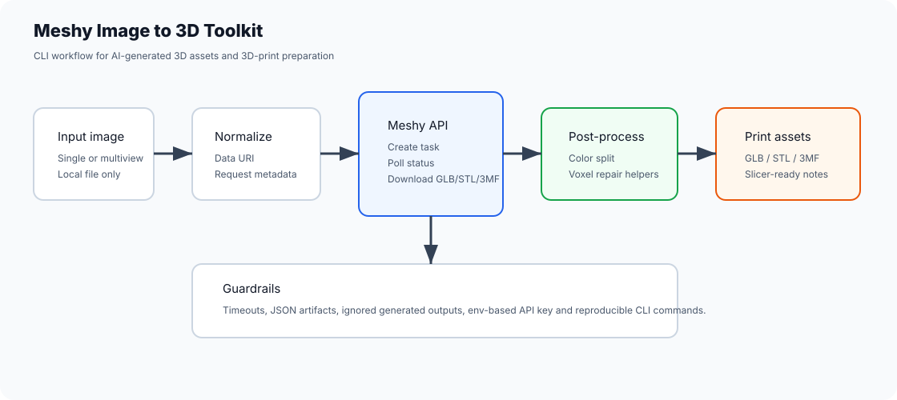
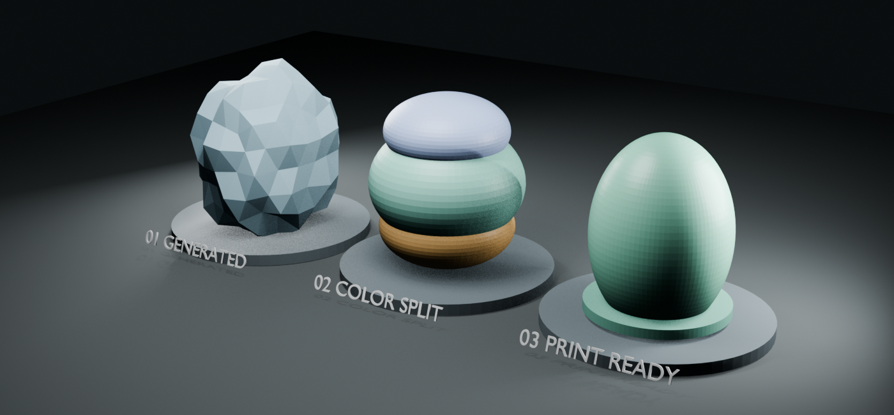

# Meshy Image to 3D Toolkit

[English / README principal](README.md) · Português (Brasil)

Conjunto de ferramentas adequado para portfólio, destinado a automatizar um fluxo de imagem para 3D com a API Meshy e, em seguida, preparar o modelo gerado para impressão 3D.





## O que demonstra

- CLIs em Node.js para os endpoints Meshy `image-to-3d`, `multi-image-to-3d` e de impressão.
- Normalização local de imagens para Data URI, sem primeiro enviar os arquivos a outro serviço.
- Consultas periódicas de estado, tratamento de tempo limite, captura de artefatos JSON e download de modelos.
- Utilitários em Python para recortes de imagens de múltiplas vistas, separação de GLB por cor e reparo por voxels no Blender.
- Planejamento prático do fluxo de impressão 3D: saídas GLB/3MF/STL, separação de cores, limpeza de texturas e arquivos prontos para o fatiador.
- Relatório determinístico de prontidão para impressão, cobrindo estanqueidade da malha, componentes conectados, volume positivo, análise preliminar de paredes finas e volume de impressão.

## Requisitos

- Node.js 18+
- Python 3.10+
- Chave da API Meshy
- Opcional: Blender para os utilitários de reparo por voxels

## Configuração

```bash
npm install
copy .env.example .env
```

Defina `MESHY_API_KEY` em `.env`.

## Comandos comuns

```bash
npm run image-to-3d -- --image samples/input.png --formats glb,3mf
```

```bash
npm run multi-image-to-3d -- --images "front.png,side.png,back.png" --formats glb,3mf
```

```bash
npm run meshy-print -- --mode analyze --task-id <task-id>
```

```bash
npm run split-by-color -- --input outputs/model.glb --output outputs/split/model
```

```bash
npm run repair-voxel -- --input outputs/split/model-preto.glb --output outputs/repaired/model-preto.stl --voxel-size 0.01
```

Gere um relatório de qualidade que possa ser inspecionado a partir de medições de malha sem dados sensíveis:

```bash
npm run mesh-quality -- docs/demo/synthetic-mesh-metrics.json --output outputs/mesh-quality-report
```

## Boas práticas do repositório

Modelos gerados, miniaturas, amostras, arquivos `.env` e respostas da API são intencionalmente ignorados. Isso mantém o repositório público focado no código e no fluxo de trabalho, sem incluir recursos privados ou arquivos gerados para clientes.

## CI

O GitHub Actions executa verificações de sintaxe do Node para as CLIs e compila os utilitários em Python.

## Perspectiva de portfólio

Este projeto é útil para recrutadores porque demonstra integração com API, ergonomia de CLI, automação de processamento de arquivos, tratamento de dados 3D e controles voltados à produção para os recursos gerados. Consulte [docs/portfolio-case-study.md](docs/portfolio-case-study.md).
